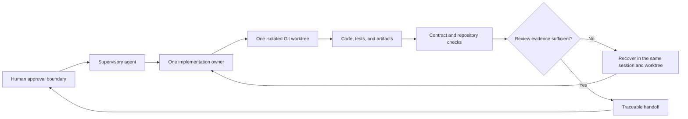

# Verifiable Agent Development Framework

A Python validator and documented workflow for reviewing software changes made by coding agents.
The validator checks a JSON handoff manifest for ownership records, file paths, recorded check results, and claim evidence references.
It is intended for developers and reviewers who need a consistent record of what changed and what still needs review.

## Quick start

Use Python 3.10 or newer.
The validator uses only the standard library and can run from the repository root without installation.

```bash
git clone https://github.com/NoahF90210/verifiable-agent-development.git
cd verifiable-agent-development
python3 -m vadf validate examples/verified_handoff.json
```

The accepted example returns exit code `0` and prints `CONTRACT VALID` plus an attestation notice.
To validate your own manifest, replace the example path with the path to your JSON file.
See the [manifest contract](docs/manifest-contract.md) for required fields and evidence-reference syntax.

| Exit code | Meaning |
| --- | --- |
| `0` | The manifest satisfies the structural contract. |
| `1` | The JSON is readable, but one or more contract rules fail. |
| `2` | The file is unreadable, non-UTF-8, malformed JSON, or contains duplicate object keys. |

A `CONTRACT VALID` result does not establish that the recorded checks ran or that the claims are true.
The validator does not execute commands, inspect evidence content, or perform the recorded privacy review.
Those records are author attestations until independently checked.

## What is implemented

The repository includes the validator, CLI, accepted and rejected example manifests, tests, publication and link checks, and CI configuration.
The validator rejects duplicate JSON keys, malformed input, failed recorded statuses, nonexclusive ownership records, unsafe path syntax, undeclared artifact or check references, and blocked claims marked for output.
It checks the manifest's ownership declaration, not actual worktree access or concurrent writers.

The role model, worktree ownership rule, recovery procedure, and PDF QA flow are documented policies.
This repository does not implement an agent orchestrator, worktree manager, or PDF renderer.
Hermes, Pi, rpiv, and the resume-optimizer scenario provide case-study context; none is required to run the validator.
See the [implementation glossary](docs/implementation-glossary.md) for those mappings.

## Workflow

A completion message alone does not establish which files changed, whether checks ran, or whether evidence supports a claim.
The documented workflow assigns one implementation owner to each isolated Git worktree and separates implementation from review and approval.

1. A human sets the objective, approval boundaries, and release decision.
2. A supervisory agent breaks the objective into tasks, monitors work, and requests independent review.
3. An implementation owner edits and tests one isolated worktree.
4. Deterministic tools check manifest structure, links, publication rules, and repository behavior.



The handoff records ownership, changed artifacts, check attestations, claims and evidence references, recovery state, privacy-review attestations, and remaining risks.
Read [Architecture](docs/architecture.md) for role boundaries, state handling, and recovery policy.

## Repository checks

Run these commands from the repository root.

```bash
python3 -m unittest discover -s tests -v
python3 -m vadf validate examples/verified_handoff.json
python3 scripts/check_markdown_links.py
python3 scripts/check_publication_rules.py
```

Run the deliberately invalid example separately; it must return exit code `1`.

```bash
python3 -m vadf validate examples/invalid_handoff.json
```

| Check | Implementation |
| --- | --- |
| Handoff contract | [`vadf/validator.py`](vadf/validator.py) |
| Duplicate-key and UTF-8 input handling | [`vadf/cli.py`](vadf/cli.py) |
| Validator and CLI regression tests | [`tests/test_validator.py`](tests/test_validator.py) |
| Publication-check failure fixtures | [`tests/test_publication_rules.py`](tests/test_publication_rules.py) |
| Git-derived publication scanner | [`scripts/check_publication_rules.py`](scripts/check_publication_rules.py) |
| Local Markdown link checker | [`scripts/check_markdown_links.py`](scripts/check_markdown_links.py) |
| CI commands | [`.github/workflows/ci.yml`](.github/workflows/ci.yml) |

## Limits

Validation checks syntax, structure, cross-references, and status consistency; it does not prove semantic truth or verify external evidence.
The publication scanner uses selected high-risk patterns and is not a comprehensive secret scanner.
Human review remains required for acceptance and release.

This sanitized reference repository excludes the private operating environment, application implementation, prompts, messages, memory, credentials, contacts, proprietary code, and personal resume data.
It provides no evidence of private application history, measured development speed, defect reduction, cost savings, accuracy gains, hiring outcomes, production deployment, users, revenue, or benchmark performance.

## Documentation

- [Architecture](docs/architecture.md)
- [Resume optimizer policy case study](docs/case-study.md)
- [Implementation glossary](docs/implementation-glossary.md)
- [Manifest contract](docs/manifest-contract.md)
- [Examples learning path](examples/README.md)
- [Contributing](CONTRIBUTING.md)
- [Security](SECURITY.md)

## License

[MIT](LICENSE).
